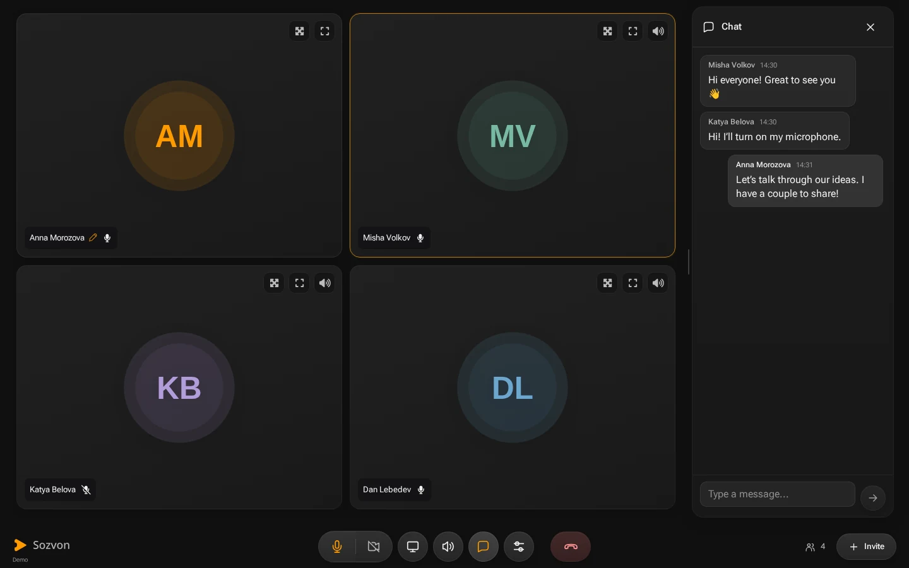
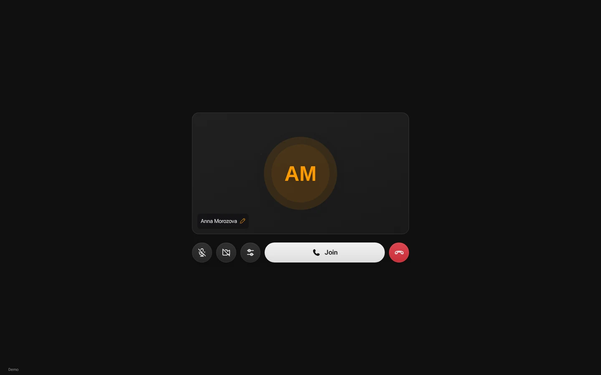
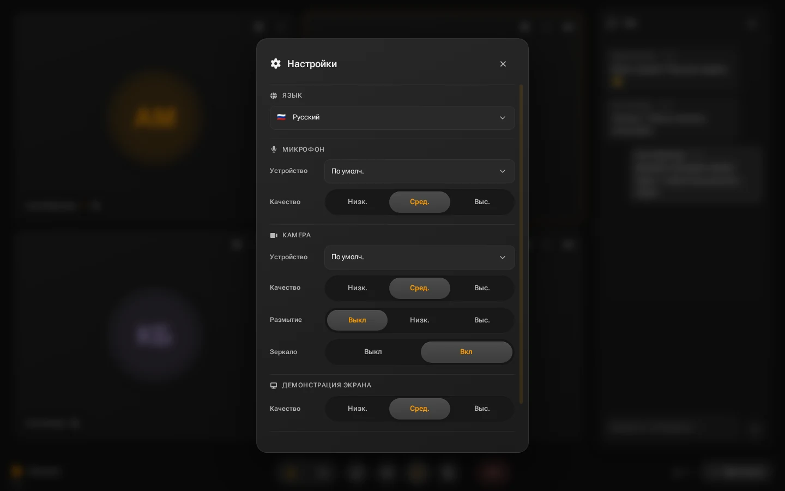
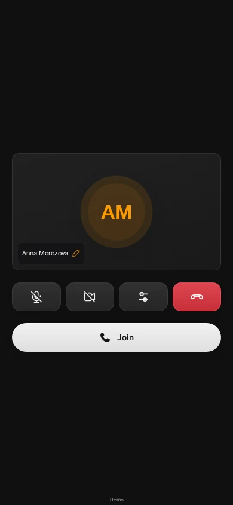
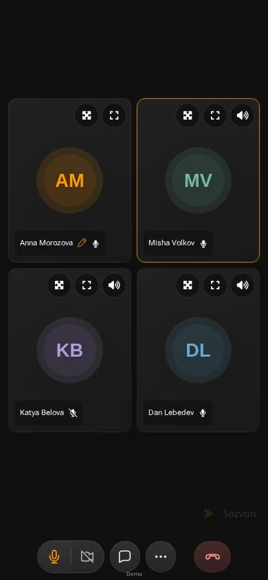

<h1 align="center">
   sozvon
</h1>

<p align="center">
  <strong>A link. A conversation. Your own server.</strong><br />
  Video meetings in your browser, without accounts or sign-up.<br />
  Share a room, turn on your microphone and bring everyone in.
</p>

<p align="center">
  <a href="https://sozvon.now">Try sozvon</a> &nbsp; | &nbsp;
  <a href="#features">Features</a> &nbsp; | &nbsp;
  <a href="#quick-start">Quick start</a> &nbsp; | &nbsp;
  <a href="docs/self-hosting.md">Self-hosting</a> &nbsp; | &nbsp;
  <a href="CONTRIBUTING.md">Contribute</a><br />
  <sub>Browser &nbsp; | &nbsp; Desktop and mobile &nbsp; | &nbsp; LiveKit SFU and P2P &nbsp; | &nbsp; MIT</sub>
</p>

<p align="center">
  <a href="https://github.com/ufna/sozvon/actions/workflows/check.yml"></a>
  <a href="docs/development.md"></a>
  <a href="LICENSE"></a>
</p>

<p align="center">
  <a href="docs/assets/readme/meeting.webp"></a>
</p>

sozvon brings audio, video, screen sharing and chat into one room. Send a link;
people choose a name and join from their browser. Check your microphone and camera
before entering, expand a participant when you need a closer look, or keep the
call beside its chat. The same interface adapts to a phone.

Run the React client, Node.js API and LiveKit SFU on your own infrastructure.
P2P mode uses the API for signaling. An optional Telegram bot creates invitations
from a command or an inline query. All three applications live in this repository.

## Features

<table>
  <tr>
    <td width="42%" valign="middle">
      <h3>Start with a link</h3>
      <p>Create a room and send its URL. No accounts to create or contact lists to maintain. Choose a display name and check your microphone and camera in the lobby before joining.</p>
    </td>
    <td width="58%">
      <a href="docs/assets/readme/lobby.webp"></a>
    </td>
  </tr>
  <tr>
    <td valign="middle">
      <h3>Keep the conversation together</h3>
      <p>Audio, camera, screen sharing and chat share one meeting. Resize the chat, expand a participant or adjust a person's volume. Keyboard controls keep common actions close at hand.</p>
    </td>
    <td>
      <a href="docs/assets/readme/meeting.webp"></a>
    </td>
  </tr>
  <tr>
    <td valign="middle">
      <h3>Make the call comfortable</h3>
      <p>Choose your devices, tune camera and screen-sharing quality, set incoming volume and switch interface language. Ten languages are included: English, Russian, German, Spanish, French, Portuguese, Chinese, Japanese, Korean and Arabic.</p>
    </td>
    <td>
      <a href="docs/assets/readme/settings.webp"></a>
    </td>
  </tr>
</table>

### The same room on your phone

The lobby and call controls adapt to narrow screens. Safe driving mode offers a
large microphone control. You can return to a recent meeting from the home screen.

<table>
  <tr>
    <th width="50%">Check before joining</th>
    <th width="50%">Stay in the conversation</th>
  </tr>
  <tr>
    <td align="center"><a href="docs/assets/readme/mobile-lobby.webp"></a></td>
    <td align="center"><a href="docs/assets/readme/mobile.webp"></a></td>
  </tr>
</table>

### Invitations from Telegram

Type `/sozvon` or use the bot inline in another chat to create a room link.
Russian and English bot messages point to the same sozvon instance. Set
`SITE_URL` to your deployment and use your own bot token.
[Bot setup](apps/bot/README.md).

## Quick start

For a local call on **Linux**, use **Node 24**, npm and Docker with Compose.
This setup uses host networking and binds the SFU to loopback; open the client
on the same machine.

```bash
git clone https://github.com/ufna/sozvon.git
cd sozvon
npm run install:apps
npm run setup:local
docker compose up -d --build sfu
npm run dev:server
```

In another terminal:

```bash
cd sozvon
npm run dev:client
```

Open **http://localhost:4000**, create a room and open its link in a second browser
profile. Setup generates independent random secrets in ignored local files and
refuses to overwrite existing configuration. The first SFU build takes longer
because it compiles the pinned upstream source. Stop it with `docker compose down`.

For other devices and public hosting, configure reachable RTC addresses,
HTTPS/WSS and your own origins. See the [self-hosting guide](docs/self-hosting.md).

## Your server, your deployment

The client, API, SFU and optional bot have separate build contexts. You control
their configuration, updates and operating environment. Room links grant access
to a call; there are no user accounts or host approval controls in the current API.

Self-hosting does not imply end-to-end encryption: SFU mode routes media through
your LiveKit server. The client also requests generated avatars from DiceBear and
uses public STUN defaults unless configured otherwise.
[Architecture and data flow](docs/architecture.md) · [Security](SECURITY.md).

## Documentation

| Guide | What it covers |
| --- | --- |
| [Self-hosting](docs/self-hosting.md) | Local setup, configuration, build contexts and public deployment requirements. |
| [Development](docs/development.md) | Repository layout, commands, browser tests and real media verification. |
| [Architecture](docs/architecture.md) | Client, API, SFU, P2P signaling and the Telegram integration. |
| [Contributing](CONTRIBUTING.md) | Bug reports, changes and the checks relevant to a pull request. |
| [Brand and screenshots](docs/assets/README.md) | Vector source, image provenance and capture instructions. |
| [Third-party notices](THIRD-PARTY-NOTICES.md) | Dependency licenses, font notices and the remaining asset review. |

## Project status

The repository is private during preparation for public release. Product
development belongs here; existing production deployments still use the legacy
release path. The remaining privacy and rights review and operational handover
are tracked in [migration status](docs/MIGRATION.md).

## Contributing

[Report a bug](https://github.com/ufna/sozvon/issues) or open a pull request.
For changes to calls, include the browser, connection mode and how the behavior
was verified. Use synthetic participants and remove credentials from diagnostics.
See [CONTRIBUTING.md](CONTRIBUTING.md).

## Contributors

**[Nikolay Prudnikov (@nprudnikov)](https://github.com/nprudnikov)** contributed
to the original client and server, including P2P calling, localization and room
validation. **[Vladimir Alyamkin (@ufna)](https://github.com/ufna)** contributes
to the applications, Telegram integration and project maintenance.

[Contribution credits and preserved authorship](CONTRIBUTORS.md).

[MIT](LICENSE)

<sub>Screenshots show the running local demo with synthetic participants, messages and local avatar fixtures. No live calls or camera feeds were captured.</sub>
