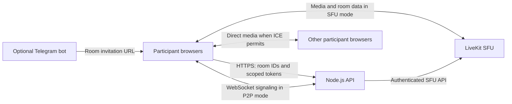

# Architecture

## Browser client

React renders the lobby, room, settings and chat. MobX stores room state and
preferences. Controllers adapt LiveKit SFU rooms and P2P connections to the same
UI. Nicknames, device settings, layout preferences and recent-room information
are stored in the browser. Microphone, camera and display sharing use browser
permissions; the `/design` route substitutes a local demo controller.

## API and signaling

`POST /room/create` returns a random UUID room ID. Token endpoints validate room
and participant UUIDs, then issue scoped one-hour tokens. The API has CORS,
request and rate limits. WebSocket signaling validates P2P JWTs, applies an
authentication deadline and bounds payloads, connections and room sizes.
`/healthz` checks the process; `/readyz` checks the SFU connection.

The current API has no accounts, room owners, passwords, waiting-room approval
or persistent access-control list. A room link provides access. Do not treat a
UUID URL as identity verification.

## Media paths

In SFU mode, participants connect to LiveKit using scoped room tokens. LiveKit
forwards media among participants; this repository does not implement application
level end-to-end encryption for that mode. Server operators control that service.
In P2P mode, browsers negotiate connections through the signaling service, then
send media over their negotiated WebRTC paths. ICE connectivity depends on the
configured STUN/TURN infrastructure and participant networks.

## External requests and operation

The client currently loads generated avatars from the DiceBear API using a
participant identifier as the seed. P2P defaults include public STUN services;
review and replace those providers for your operating environment. Hosting the
API and SFU yourself does not automatically remove these external requests.

The optional Telegram bot generates UUID room links; it does not join calls or
forward media. Telegram receives bot interactions. Running the bot also updates
its profile and command list. `SITE_URL` chooses the instance used by all locales.

The product source is separate from production infrastructure. Runtime secrets,
DNS, certificates, backup/restore and rollout belong in private ops.
